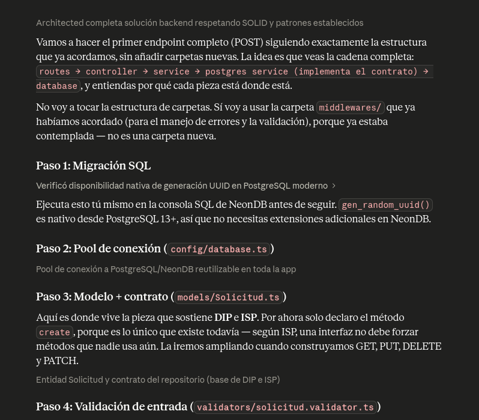
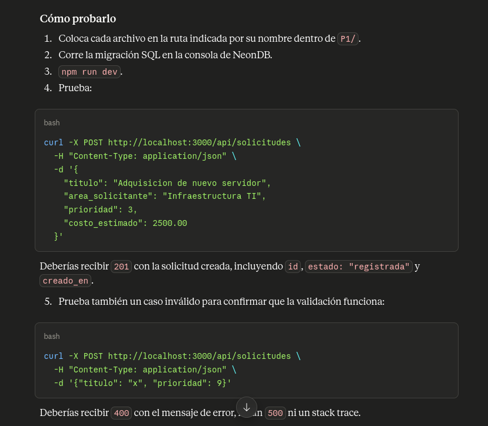
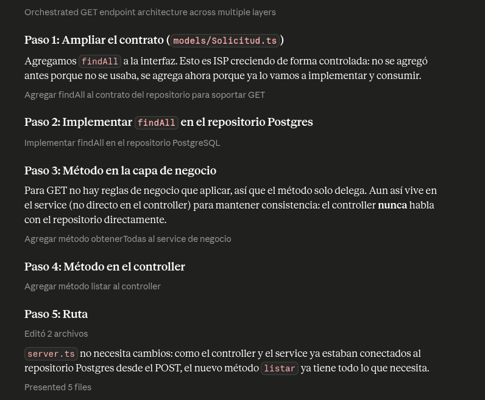
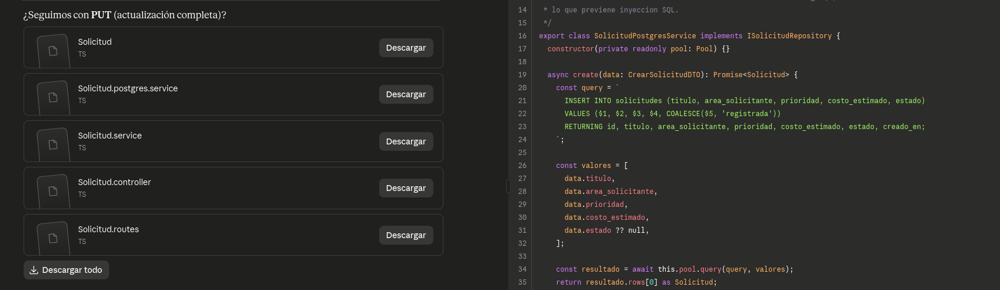
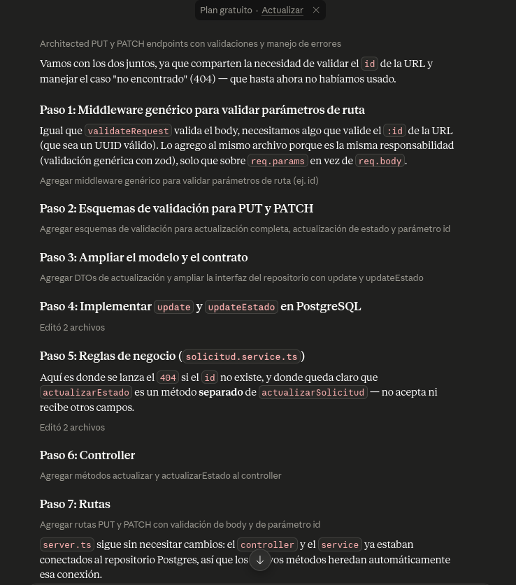
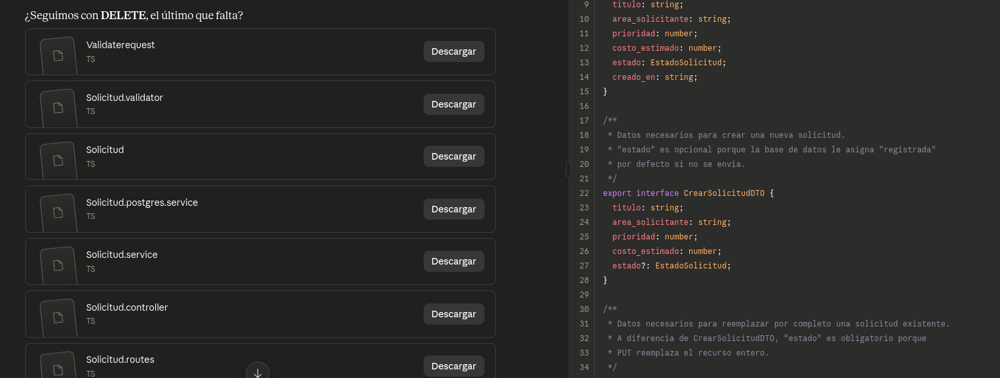

# Prompts

IA utilizada: Claude

## 1. Conexion inicial  con neonDB

### 1.1 Prompt

Siguiendo la arquitectura de carpetas actual, me ayudaras con la primera  conexion con neonDB, tengo creado el proyecto con el connection string, siempre siguiendo los principios solid, me enseñaras a realizar una peticion sencilla, por ejemplo  un post, con la finalidad de saber como continuar.

restricciones:

* No modificaras la estructura de carpetas actual, si consideras que deberian tener un cambio, me notificaras y justificaras el porque del cambio
* Respetaras los principios  solid

### 1.2 Respuesta

### 1.3 Analisis

### 2. Endpoint GET (Con POST ya implementado)

### 2.1 Prompt
Necesito agregar un endpoint GET que liste todas las solicitudes operativas, siguiendo la misma arquitectura en capas (routes/controller/service/repository) que ya tengo para el POST. Debe respetar la interfaz ISolicitudRepository existente, usar consultas parametrizadas y devolver 200 con un array JSON.

### 2.2 Respuesta

### 2.3 Analisis 

- Verifique que el ORDER BY no permitiera inyeccion (no recibe input del
  usuario, es una constante en el codigo).
- Confirme que el metodo se agrego a la interfaz ISolicitudRepository
  antes de implementarlo, para mantener consistencia con ISP.
- Ajuste el nombre del metodo en el service a "obtenerTodas" en español
  para mantener consistencia con "crearSolicitud".

### 3. Endpoints PUT y PATCH con manejo de 404

### 3.1 Prompt
Agrega actualizacion completa (PUT) y actualizacion exclusiva de estado
(PATCH) siguiendo la arquitectura existente. El PATCH no debe poder
modificar ningun otro campo aparte de estado, ni siquiera si el cliente
lo envia. Si el id no existe, debe responder 404 usando la clase AppError
que ya existe en el proyecto.

### 3.2 Respuesta

### 3.3 Analisis 

- La IA inicialmente puso el chequeo de "no encontrado" dentro del
  repositorio (haciendo que haya un error). Lo modifique para que el repositorio devuelva null y sea el SolicitudService quien decida   lanzar el 404, manteniendo la logica de negocio fuera de la capa
  de acceso a datos (separacion de responsabilidades).
- Separe "actualizarEstado" como metodo independiente de "actualizarSolicitud" en el service, en vez de un unico metodo con parametros opcionales, para que fuera imposible pasar accidentalmente otros campos al actualizar solo el estado.
- Agregue validacion de formato UUID en el :id antes de llegar al controller, para evitar una consulta innecesaria a la base de datos con un id mal formado.