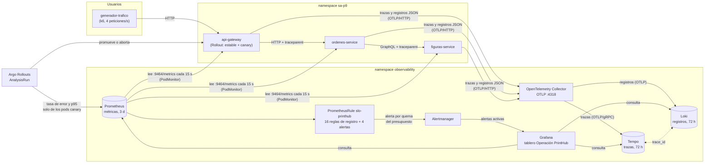

# Flujo de la telemetría

Recorrido de cada señal desde el servicio hasta el tablero, la alerta y la decisión del canary.
Todo lo que aparece aquí lo despliega ArgoCD desde el
[repositorio GitOps](https://github.com/GeoNufio1404/software-avanzado-gitops) (namespace
`observability` para el stack, `sa-p9` para la plataforma).

## Las tres señales

| Señal | Cómo sale del servicio | Por dónde pasa | Dónde queda | Cómo se consulta |
|---|---|---|---|---|
| **Trazas** | SDK de OpenTelemetry (`src/instrumentacion.mjs`, cargado con `node --import`) instrumenta http, express, fetch, GraphQL y amqplib. El contexto viaja entre servicios en la cabecera W3C `traceparent` | Collector (OTLP/HTTP `:4318`) → Tempo (OTLP/gRPC `:4317`) | Tempo | Grafana → Tempo (TraceQL) |
| **Registros** | `pino` en JSON (`src/observabilidad.js`); la instrumentación de pino les agrega `trace_id` y `span_id` y los envía por OTLP. También salen por stdout | Collector → Loki (`/otlp`) | Loki, con `service_name`, `trace_id` y `severity_text` como campos consultables | Grafana → Loki (LogQL) |
| **Métricas** | Exportador Prometheus del SDK en el propio pod (`:9464/metrics`): histograma `printhub_http_request_duration_seconds` y contadores de negocio `printhub_pedidos_creados_total` y `printhub_pedidos_rechazados_total` | **No pasan por el Collector**: Prometheus las lee directo del pod (`PodMonitor` `sa-platform-servicios`, cada 15 s) | Prometheus, con la etiqueta `rollouts_pod_template_hash` de cada pod | Tablero, reglas del SLO y AnalysisTemplate |

Las métricas no pasan por el Collector a propósito. Al leerlas directo de cada pod, Prometheus
conserva la etiqueta `rollouts_pod_template_hash`, y con ella el AnalysisTemplate mide **solo** el
tráfico que atendieron los pods canary.

## Correlación entre señales

- **De una traza a sus registros:** en Grafana, *Logs for this span* abre Loki filtrado por
  `service_name` y `trace_id` (datasource Tempo, `tracesToLogsV2`).
- **De un registro a su traza:** el campo `trace_id` de cada registro es un enlace a Tempo
  (datasource Loki, `derivedFields`).
- **De una métrica a una traza:** el panel *¿Qué peticiones fallaron?* del tablero lista las
  trazas con error (Tempo, `{ status = error }`).

## Del fallo a la alerta: cuánto tarda cada salto

| Salto | Intervalo |
|---|---|
| Petición → métrica disponible en Prometheus | ≤ 15 s (lectura del PodMonitor) |
| Métrica → reglas de registro del SLO | cada 30 s |
| Regla → alerta `pending` → `firing` | `for: 1m` (rápida) o `for: 5m` (lenta) |
| Fallo del 100 % de los pedidos → alerta rápida | ~9–10 min: la ventana de 1 h tiene que pasar de 14.4 % de errores ([cálculo en slo.md](slo.md#alertas)) |
| Traza/registro → disponible en Tempo/Loki | segundos (lote del Collector) |
| Canary → decisión del AnalysisRun | primera medición al minuto del paso y luego una por minuto, 3 por paso, con una ventana de 2 min |

## Lo que la telemetría gobierna

1. **El canary.** En cada paso del Rollout (20/50/80 %), un AnalysisRun consulta Prometheus. Si la
   tasa de 5xx de los pods canary es ≥ 1 % o su p95 es ≥ 0.5 s en 2 mediciones, Argo Rollouts
   aborta y vuelve a la versión estable sin intervención.
2. **Las alertas.** Las 4 alertas de `slo-printhub` saltan por consumo del presupuesto de error,
   nunca por un umbral instantáneo. Cada una lleva `runbook_url` a su procedimiento en
   [`runbooks/`](runbooks/).
3. **El diagnóstico.** El tablero responde dónde está el problema (servicio y señal de oro), la
   traza dice en qué salto y el registro dice por qué.
