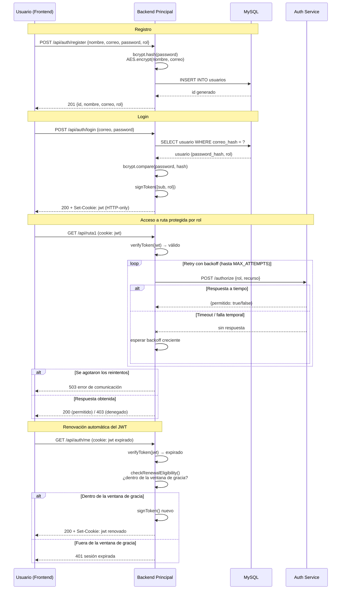

# Práctica 2 — Autenticación y Autorización

**Curso:** Software Avanzado, Segundo Semestre 2026
**Estudiante:** Geovanni Eduardo Nufio Illescas — Carné 201901444
---

## 1. Descripción general

Módulo de registro, login y autorización por roles (`admin` / `cliente`) para una
aplicación full-stack, compuesto por **tres servicios independientes**:

| Servicio | Responsabilidad | Puerto |
|---|---|---|
| `backend` | API REST de autenticación, orquesta la sesión (JWT, cookies, encriptación) | 4000 |
| `auth-service` | Microservicio de autorización: decide si un rol puede acceder a un recurso | 5000 |
| `frontend` | React + Vite: registro, login, página de confirmación | 3000 |

`mysql` corre como cuarto contenedor, con persistencia de datos.

El punto central del diseño es que **autenticación y autorización están
deliberadamente desacopladas**: el backend sabe validar identidad (¿quién eres?)
pero delega por completo la decisión de permisos (¿qué puedes hacer?) al
microservicio, consultándolo mediante un cliente HTTP con reintentos y backoff
configurable, en vez de asumir acceso o fallar de forma abrupta ante un problema
temporal de red.

---

## 2. Tecnologías utilizadas

| Tecnología | Por qué se eligió | Ventaja principal | Desventaja / trade-off |
|---|---|---|---|
| **Node.js + Express** | Backend liviano, ecosistema conocido, ideal para APIs REST pequeñas | Rápido de levantar, middleware nativo para auth (`cookie-parser`, `cors`) | Callback/async mal manejado puede generar código difícil de seguir; mitigado usando `async/await` consistentemente |
| **React + Vite** | Frontend con recarga instantánea en desarrollo, sin configuración compleja | Build y dev server mucho más rápidos que Webpack/CRA | Ecosistema de plugins algo más joven que Webpack; no fue un problema en un proyecto de este tamaño |
| **MySQL** | Base de datos relacional pedida por el enunciado, con soporte maduro para tipos como `ENUM` (usado en `rol`) | Transaccional, `UNIQUE` en `correo_hash` garantiza integridad sin lógica extra en la app | Requiere definir el esquema por adelantado; no es un problema aquí porque el modelo de datos es simple y estable |
| **JWT (jsonwebtoken)** | Requisito del enunciado; permite autenticación *stateless* (el backend no necesita guardar sesiones en memoria/BD) | Escala horizontalmente sin sesión compartida | El token no se puede "revocar" antes de que expire sin lógica extra (ej. lista negra); se mitiga con tiempos de vida cortos + renovación controlada |
| **Cookies HTTP-only** | Requisito del enunciado; evita que el JWT sea legible o robable vía JavaScript (XSS) | El navegador nunca expone el token a `document.cookie` | Requiere configurar CORS con `credentials: true` en ambos lados (frontend y backend); ya resuelto en `cors()` y `fetch(..., { credentials: 'include' })` |
| **AES-256-GCM** (`crypto` nativo de Node) | Requisito del enunciado para encriptar datos sensibles (nombre, correo) | Cifrado autenticado: además de ocultar el dato, detecta si fue alterado (`authTag`) | Es reversible por diseño — por eso **no** se usa para la contraseña (ver sección de decisiones técnicas) |
| **bcrypt** | Estándar de la industria para contraseñas | Hash irreversible con salt automático; resistente a fuerza bruta por diseño (costo configurable) | Más lento que un hash simple a propósito — es una ventaja de seguridad, no una desventaja real |
| **Docker / Podman Compose** | Reproducibilidad: los 4 servicios se levantan igual en cualquier máquina | Aísla dependencias, evita "en mi máquina sí funciona" | Curva de aprendizaje inicial (variables de entorno, redes internas, bind mounts) |

### Decisión técnica: por qué la contraseña usa hash y no AES

El enunciado menciona encriptar "nombres, correos, contraseñas" con AES. Sin
embargo, en este proyecto la contraseña se guarda con **bcrypt (hash)**, no con
AES (cifrado). La razón es de seguridad, no de conveniencia: AES es *reversible*
— con la clave correcta, cualquiera puede recuperar el texto original. Una
contraseña nunca debería ser recuperable, ni siquiera por el propio sistema; si
la base de datos se filtra, un hash bcrypt no revela la contraseña real, mientras
que un valor AES sí, si además se filtra la clave. Nombre y correo sí usan AES
porque, a diferencia de la contraseña, el sistema necesita leerlos de vuelta
(por ejemplo, para mostrarlos en la página de confirmación).

---

## 3. Principios SOLID aplicados

### 3.1 Single Responsibility Principle (SRP)

Cada módulo tiene una única razón para cambiar. Por ejemplo, `aes.js` solo sabe
encriptar/desencriptar — no sabe qué es un usuario ni toca la base de datos:

```js
// backend/src/utils/aes.js
function encrypt(plainText) {
  const iv = crypto.randomBytes(IV_LENGTH);
  const cipher = crypto.createCipheriv(ALGORITHM, KEY, iv);
  const encrypted = Buffer.concat([cipher.update(String(plainText), 'utf8'), cipher.final()]);
  const authTag = cipher.getAuthTag();
  return [iv.toString('hex'), authTag.toString('hex'), encrypted.toString('hex')].join(':');
}
```

De igual forma, `user.model.js` solo sabe hacer queries SQL, y `auth.controller.js`
solo orquesta (valida entrada, llama a `aes`, a `bcrypt`, al modelo, y responde).
Si mañana cambia el motor de base de datos, solo se toca `user.model.js`; si
cambia el algoritmo de cifrado, solo se toca `aes.js`.

### 3.2 Open/Closed Principle (OCP)

El middleware de autorización está abierto a extensión sin modificar su código
existente. `requireRole` es una *factory* que acepta cualquier combinación de
roles:

```js
// backend/src/middleware/auth.middleware.js
function requireRole(...rolesPermitidos) {
  return (req, res, next) => {
    if (!rolesPermitidos.includes(req.user.rol)) {
      return res.status(403).json({ error: 'No tienes permiso para acceder a este recurso.' });
    }
    return next();
  };
}
```

De la misma manera, agregar un nuevo recurso protegido no requiere tocar el
microservicio de autorización, solo agregar una entrada al mapa:

```js
// auth-service/src/permissions.js
const RESOURCE_ROLES = {
  ruta1: ['admin'],
  ruta2: ['admin', 'cliente'],
  // ruta3: ['admin'],  <- así se extendería, sin tocar authorize.controller.js
};
```

### 3.3 Liskov Substitution Principle (LSP)

Todo middleware de Express en este proyecto (`requireAuth`, `requireResourceAccess`,
`requireRole`) respeta la misma firma `(req, res, next) => void`. Esto permite
componerlos e intercambiarlos libremente en cualquier cadena de rutas sin que
ninguno rompa el contrato que Express espera:

```js
// backend/src/routes/protected.routes.js
router.get('/ruta1', requireAuth, requireResourceAccess('ruta1'), (req, res) => { ... });
router.get('/ruta2', requireAuth, requireResourceAccess('ruta2'), (req, res) => { ... });
```

Cualquiera de estos middlewares puede sustituirse por otro que cumpla la misma
firma (por ejemplo, un futuro `requireApiKey`) sin alterar cómo Express ni las
rutas los invocan.

### 3.4 Interface Segregation Principle (ISP)

En el frontend, el cliente HTTP no expone una única API monolítica con todos los
métodos mezclados. Se separa en interfaces pequeñas y específicas según quién las
consume:

```js
// frontend/src/api/client.js
export const authApi = { register, login, logout, me };
export const resourceApi = { ruta1, ruta2 };
```

`LoginPage` solo importa `authApi` — nunca se ve forzado a depender de
`resourceApi.ruta1`, que no le interesa. `AuthorizationDemo` solo importa
`resourceApi`. Cada consumidor depende únicamente de lo que usa.

### 3.5 Dependency Inversion Principle (DIP)

`authorize.middleware.js` (el consumidor de alto nivel) no depende de los
detalles concretos de cómo se consulta al microservicio (fetch, timeout, retry,
backoff) — depende de una función abstracta que responde una pregunta simple:

```js
// backend/src/middleware/authorize.middleware.js
const { checkAuthorization } = require('../utils/authServiceClient');

async function requireResourceAccess(recurso) {
  return async (req, res, next) => {
    const { permitido, error } = await checkAuthorization(req.user.rol, recurso);
    // ...
  };
}
```

Toda la complejidad de retry loop, backoff y timeouts vive encapsulada dentro de
`authServiceClient.js`. Si mañana se cambia `fetch` por `axios`, o el protocolo
de comunicación con el microservicio, `authorize.middleware.js` no se entera —
sigue dependiendo de la misma abstracción (`checkAuthorization(rol, recurso)`).

---

## 4. Diagrama de secuencia



---

## 5. Instrucciones de ejecución

### Requisitos previos

- Docker o Podman + `podman-compose` / `docker-compose`
- Puertos libres: `3000`, `4000`, `5000`, `3306`

### Levantar el proyecto

```bash
cd P2
podman-compose up -d --build
```

Verifica que los 4 contenedores estén corriendo:

```bash
podman ps
```

Abre `http://localhost:3000` en el navegador. Desde ahí puedes registrarte,
iniciar sesión, y en la página de confirmación probar en vivo el acceso a
Ruta 1 (solo Admin) y Ruta 2 (Admin y Cliente).

### Variables de entorno relevantes

| Variable | Ubicación | Qué controla |
|---|---|---|
| `JWT_EXPIRATION_SECONDS` | `backend/.env` | Tiempo de vida del JWT |
| `JWT_RENEWAL_GRACE_SECONDS` | `backend/.env` | Ventana tras expirar en la que el JWT aún se puede renovar automáticamente |
| `AES_SECRET_KEY` | `backend/.env` | Clave de 32 bytes (hex) para encriptar nombre/correo |
| `AUTH_SERVICE_RETRY_MAX_ATTEMPTS` | `backend/.env` | Número máximo de reintentos al consultar el microservicio |
| `AUTH_SERVICE_RETRY_BACKOFF_MS` | `backend/.env` | Backoff base entre reintentos (crece linealmente por intento) |
| `AUTH_SERVICE_TIMEOUT_MS` | `backend/.env` | Timeout por intento antes de considerarlo fallido |

Detalle operativo completo (cómo conectarse a MySQL, probar cada endpoint con
`curl`, reconstruir un solo servicio, etc.) está en `SETUP.md`, en la raíz del
repositorio.

---

## 6. Estructura del repositorio

```
P2/
├── auth-service/       # Microservicio de autorización (puerto 5000)
├── backend/             # API principal de autenticación (puerto 4000)
├── frontend/             # React + Vite (puerto 3000)
├── docker-compose.yml
├── SETUP.md              # Guía operativa (no es este documento)
└── README.md             # Este documento
```