# Practica 3

Geovanni Eduardo Nufio Illescas 
201901444

# Indice

- [1. Tecnologías y patrones de diseño](#1-tecnologias-y-patrones-de-diseño)
- [2. Arquitectura General](#2-arquitectura-general)
- [3. Diseño de microservicios](#3-diseño-de-microservicios)
  - [3.1 Autenticación](#31-autenticacion)
  - [3.2 Transacciones](#32-transacciones)
  - [3.3 Aprobación](#33-aprobacion)
  - [3.4 Core bancario](#34-core-bancario)
  - [3.5 Notificaciones](#35-notificaciones)
  - [3.6 Historial](#36-historial)
- [4. Diagrama de Componentes UML](#4-diagrama-de-componentes-uml)
- [5. Flujo de Aprobación](#5-flujo-de-aprobacion)
- [6. Diagramas de Secuencia](#6-diagramas-de-secuencia)
  - [6.1 Secuencia de Aprobación](#61-secuencia-de-aprobacion)
  - [6.2 Secuencia Core Bancario](#62-secuencia-core-bancario)
  - [6.3 Secuencia Notificaciones](#63-secuencia-notificaciones)
- [7. Estrategia de almacenamiento de archivos CSV](#7-estrategia-de-almacenamiento-de-archivos-csv)
- [8. Estrategia de Logging Centralizado](#8-estrategia-de-logging-centralizado)
- [9. Comunicación entre servicios](#9-comunicacion-entre-servicios)

---

## 1. Tecnologias y patrones de diseño

### 1.1 Tecnologias

Autenticacion: OAuth (Token 12h) + JWT + AES
Almacenamiento: Cloud Storage o FTP para los CSV
Comunicacion: REST y RabbitMQ
API Gateway: Express Gateway
Modelado:  Draw.io
Despliegue: Docker y Kubernetes

### 1.2 Patrones de diseño

* Service Layer — cada microservicio expone su lógica vía una clase orquestadora (LoteService, AprobacionService, CoreBancarioAdapterService, NotificacionService, HistorialService, AuthService).
* Repository — acceso a datos detrás de una interfaz (LoteRepository, AprobacionRepository, EnvioRepository, NotificacionRepository, HistorialRepository), desacoplado del motor de BD.
* Adapter / capa anticorrupción — CoreBancarioClient y EmailSender aíslan protocolos externos (core bancario, SMTP) del resto del sistema.
* CQRS — Historial no escribe datos originales, solo mantiene un modelo de lectura poblado por eventos (ProyeccionEventoListener), separando consulta de escritura.
* Event-driven / Pub-Sub — EventPublisher desacopla a los servicios de RabbitMQ directamente, publicando eventos sin conocer a los consumidores.

---

## 2. Arquitectura General

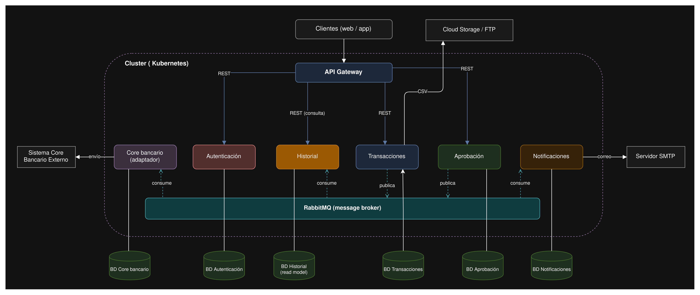

El sistema reemplaza el monolito actual por una arquitectura de microservicios, en los cuales se esta teniendo en cuenta los siguientes mircroservicios:

1. Autenticacion
2. Transacciones
3. Aprobacion
4. Core bancario
5. Notificaciones
6. Historial

Cada microservicio es dueño de us propia base de datos; sin acceso cruzado entre ellas, un api agteway centraliza el punto de entrada para los clientes y expone unicamente los servicios que requieren acceso directo (autenticacion, transacciones, aprobacion, historail); Core bancario y Notificaciones no rebien trafico externo, solo reaccionan a los eventos internos.

### 2.1 API Gateway

El API Gateway actúa como único punto de entrada del sistema y cumple tres funciones principales:

1. Enrutamiento: dirige cada petición al microservicio correspondiente según la ruta solicitada.
2. Autenticación centralizada: valida el token OAuth (emitido por el microservicio de Autenticación) antes de dejar pasar cualquier petición, evitando que cada microservicio reimplemente esa lógica.
3. Punto único de políticas transversales: rate limiting, logging de acceso y CORS se configuran una sola vez en el Gateway en lugar de en cada servicio.

Tecnología propuesta: cualquier gateway ligero compatible con Node.js/Express (ej. Express Gateway, o un gateway propio construido con http-proxy-middleware), consistente con el stack usado en la Práctica 2.

---

## 3. Diseño de microservicios

### 3.1 Autenticacion

#### 3.1.1 ER Autenticacion

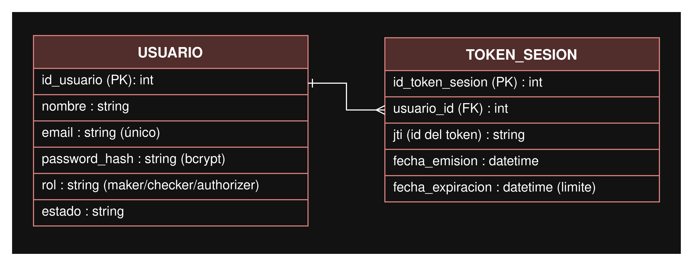

El modelo se reutiliza de la practica 2, donde se utiliza bcrypt y AES para el hashing de contraseñas y el cifrado de tokens de refresco. estos tokens tienen una vida util de 12 horas.

#### 3.1.2 UML Autenticacion

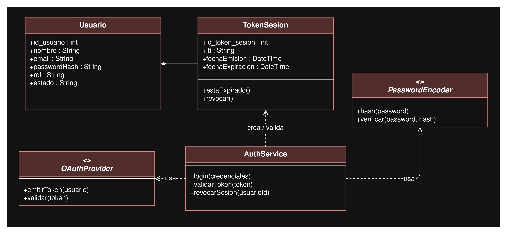

AuthService orquesta el login y la validacion de tokens, usa dos interfaces para aislar dependecnias externas: OAuthPRovider (abstra al proveedor OAuth) y PasswordEncoder (implementa bcrypt).

---

### 3.2 Transacciones

#### 3.2.1 ER Transacciones

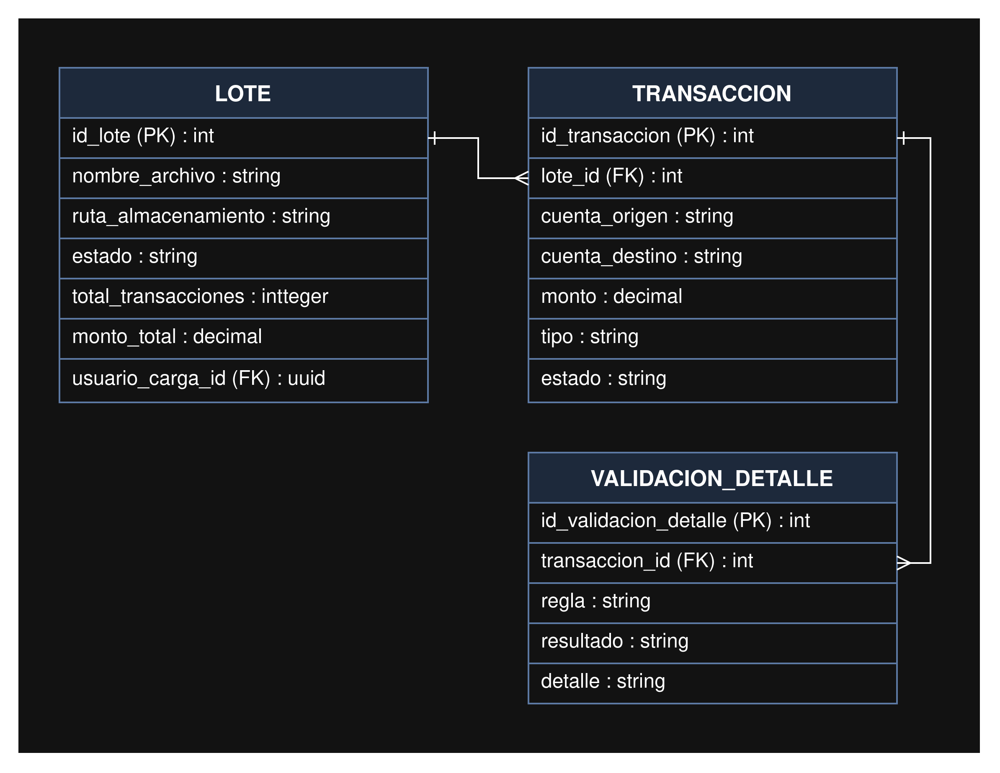

El detalle de validacion queda separado con la finalidad de auditar cada regla aplicada  (osea cosas como el saldo, limite, cuenta, fraude, etc), no solamente el resultado final.

#### 3.2.2 UML Transacciones

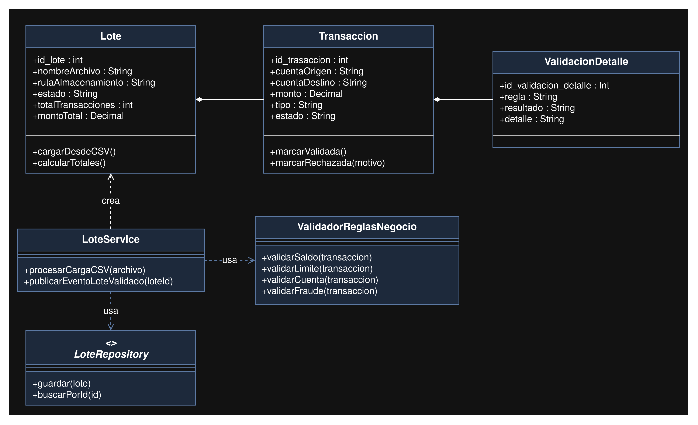

LoteService es el orqeustador, ValidadorReglasNegocio es el qeu contiene la logica asilada y LoteRepository es la interfaz con el patron Repository.

---

### 3.3 Aprobacion

#### 3.3.1 ER Aprobacion

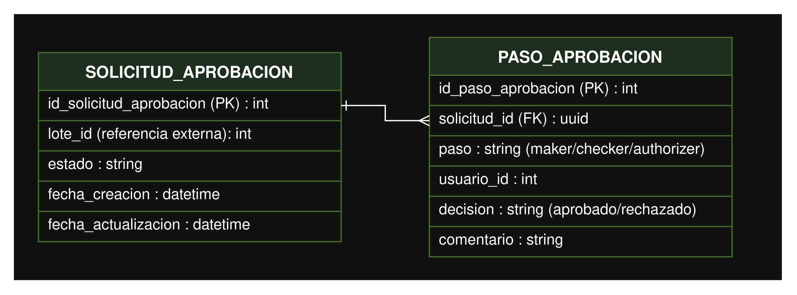

Solicitud de aprobaciiones dependiendo de si es maker/checker/authorize, lote_id es referencia externa, no un FK tal como tal porque pertenecen a dbs diferntes.

#### 3.3.2 UML Aprobacion

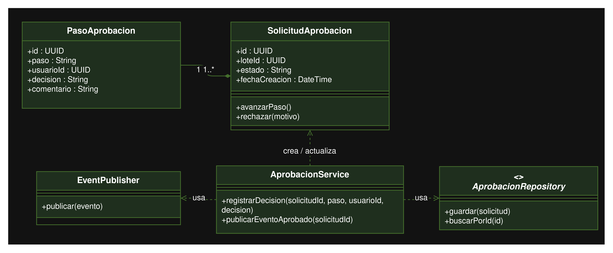

AprobacionService es el orquestador del cambio de estado, AprobacionRepository es la interfaz con el patron Repository y EventPublisher es el que se encarga de publicar en RabbitMQ.

La secuencia va asi: 

1. maker
2. checker
3. authorizer
4. Publicacion en RabbitMQ

---

### 3.4 Core bancario

#### 3.4.1 ER Core bancario

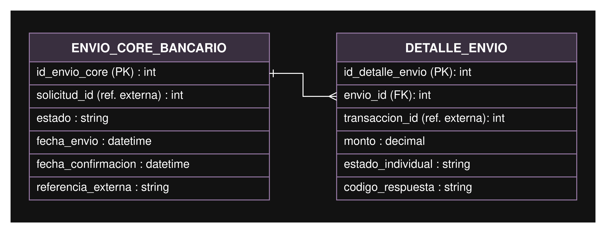

Se tiene un envio con varios detalles, uno por transaccion individual dentro del lote enviado, asi se puee rastrear si una transaccion especifica fallo aunque el lote general se haya enviado.

#### 3.4.2 UML Core bancario

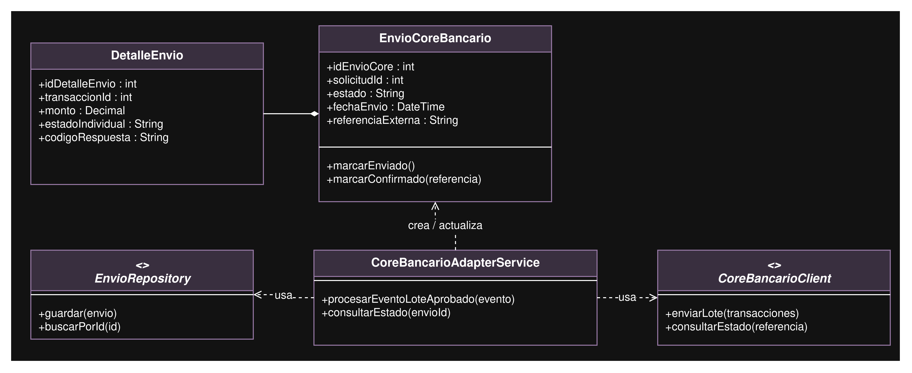

CoreBancarioAdapterService orquesta, CoreBancarioCliente es uan interfaz que actua como capa anticorrupcion, aisla el protocolo especifico del sistema externo del resto de la arquitectura.

Secuencia:
1. Consume el evento de RabbitMQ
2. Construye el evento
3. Llama al cliente adaptador
4. Se habla con el sistema externo
5. Guarda el resultado.

---

### 3.5 Notificaciones

#### 3.5.1 ER Notificaciones

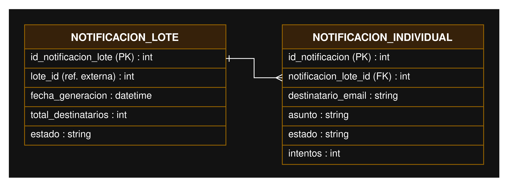

Se envia un registro por cada corre enviado a un beneficiario del lote. Esto responde directamente al requisito de enviar correa a todos los clientes/beneficiarios de un lote.

#### 3.5.2 UML Notificaciones

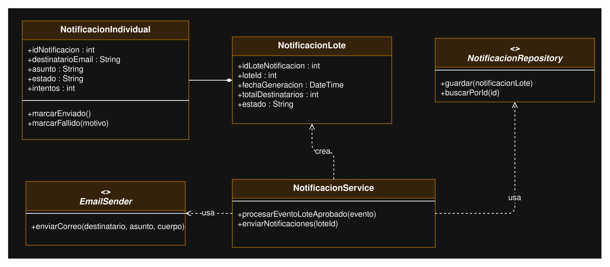

NotificacionService orquesta el envio, usa EmailSender como interfaz que actua como adaptador hacia el SMTP, el mismo patron que CoreBancarioClient.

---

### 3.6 Historial

#### 3.6.1 ER Historial

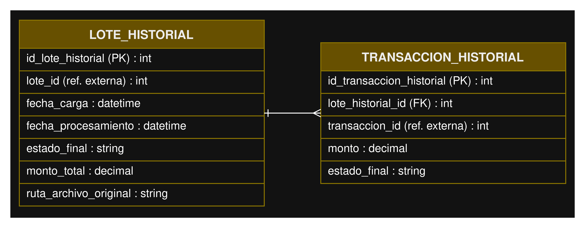

Este microservicio no utiilza datos originales, es decir es un modelo de lectura que se alimenta de eventos publicados por transacciones y aprobacion.

#### 3.6.2 UML Historial

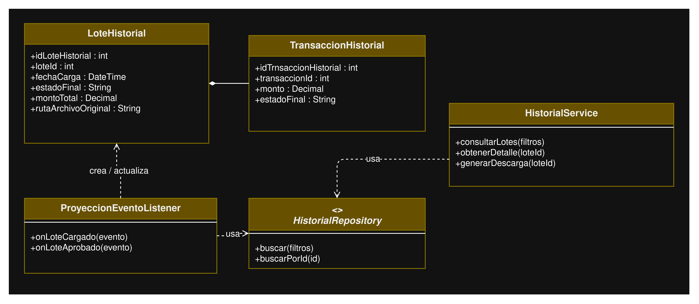

HistorialService atiende las consultas y descargas (consultarLotes, generarDescarga). ProyeccionEventoListener escucha los eventos de RabbitMQ y construye/actualiza este modelo de lectura en segundo plano. Esto es una aplicación del patrón CQRS (Command Query Responsibility Segregation): se separa quién escribe (Transacciones/Aprobación) de quién consulta (Historial).

---

## 4. Diagrama de Componentes UML

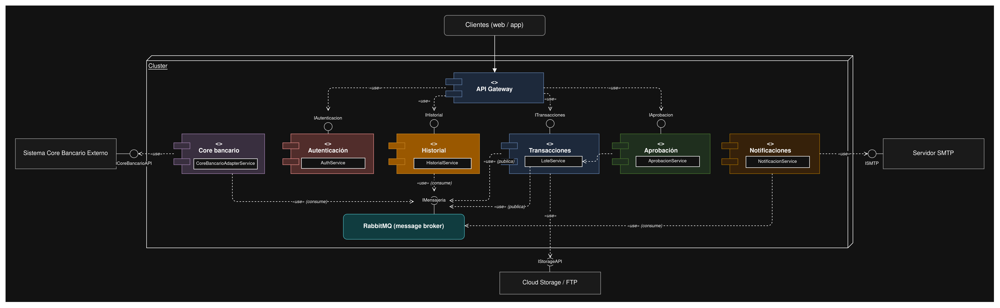

---

## 5. Flujo de Aprobacion

El flujo garantiza que ninguna transacción se envíe al sistema core bancario sin haber sido revisada por tres roles distintos, evitando que una sola persona pueda aprobar una transacción de principio a fin.

* Maker: usuario que carga o marca la solicitud de aprobación inicial sobre un lote de transacciones ya validado por reglas de negocio. Estado pasa a pendiente_checker.
* Checker: revisa el lote y confirma que los datos son correctos. Estado pasa a pendiente_authorizer.
* Authorizer: da la aprobación final. Estado pasa a aprobado, y en ese momento se publica el evento LoteAprobado de forma asíncrona hacia RabbitMQ.

Cada paso queda registrado individualmente (usuario, decisión, fecha, comentario) en la entidad PasoAprobacion, lo que hace el proceso completamente auditable. Si cualquiera de los tres roles rechaza, el flujo se detiene y el estado pasa a rechazado sin avanzar más.

---

## 6. Diagramas de Secuencia

### 6.1 Secuencia de Aprobacion

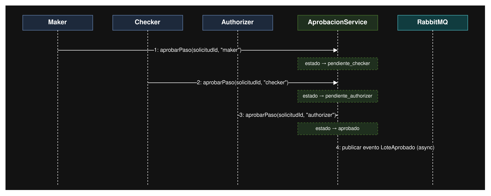

### 6.2 Secuencia Core Bancario

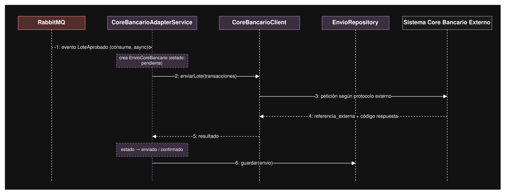

### 6.3 Secuencia Notificaciones

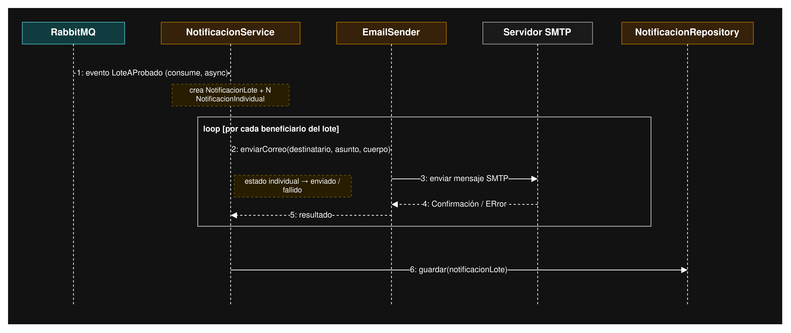

---

## 7. Estrategia de almacenamiento de archivos CSV

Los archivos CSV cargados por los usuarios se almacenan en almacenamiento en la nube (AWS S3, o alternativamente un servidor FTP), nunca en el sistema de archivos local de los contenedores (que son efímeros). El microservicio de Transacciones:

* Recibe el archivo, lo sube al bucket/servidor de almacenamiento.
* Guarda únicamente la ruta/referencia del archivo (ruta_almacenamiento) en su base de datos, no el contenido binario.
* Cada transacción individual del CSV se persiste como un registro propio (Transaccion), permitiendo validar y consultar cada una sin tener que releer el archivo completo.

Esto permite que el archivo original quede disponible para auditoría o descarga posterior sin sobrecargar la base de datos relacional con contenido de archivos.

---

## 8. Estrategia de Loggin Centralizado

Se propone un stack tipo EFK (Elasticsearch, Fluentd/Fluent Bit, Kibana), donde cada microservicio envía sus logs estructurados (JSON) a un colector central en lugar de escribir solo en su propio contenedor. Esto es indispensable porque:

* Los logs de un contenedor se pierden si el contenedor se reinicia o escala.
* Un incidente que involucra a varios microservicios (ej. una transacción que falla en el envío al core bancario) requiere poder correlacionar logs de distintos servicios por un mismo id de transacción o lote.

Cada log debe incluir como mínimo: timestamp, microservicio de origen, nivel (info/warn/error), id de correlación (lote/transacción), y el mensaje. Kibana permite consultar y auditar ese historial de forma centralizada, cumpliendo el requisito de que el sistema sea "auditable".

---

## 9. Comunicacion entre servicios

Se usa un modelo híbrido, justificado caso por caso:

* Síncrono (REST) — cuando el usuario espera una respuesta inmediata:

    * Cliente → Gateway → Autenticación (login)
    * Cliente → Gateway → Historial (consultas)
    * Cliente → Gateway → Aprobación (registrar una decisión maker/checker/authorizer)

* Asíncrono (RabbitMQ) — cuando no debe bloquearse el flujo principal:

    * Transacciones → Aprobación (lote validado, listo para revisión)
    * Aprobación → Core bancario y Notificaciones (evento LoteAprobado)
Todos los servicios → Logging centralizado

---
