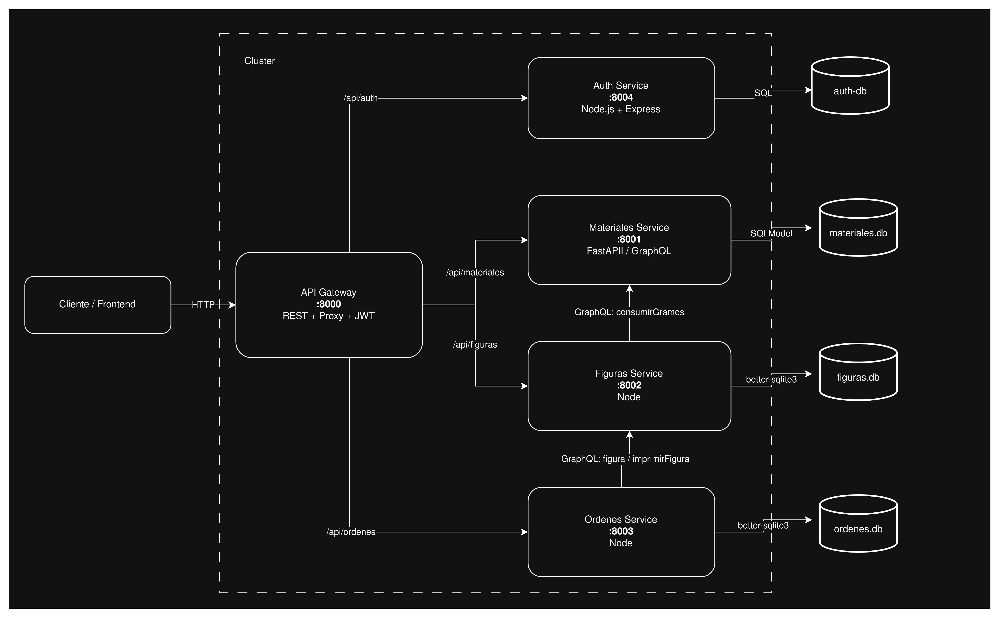
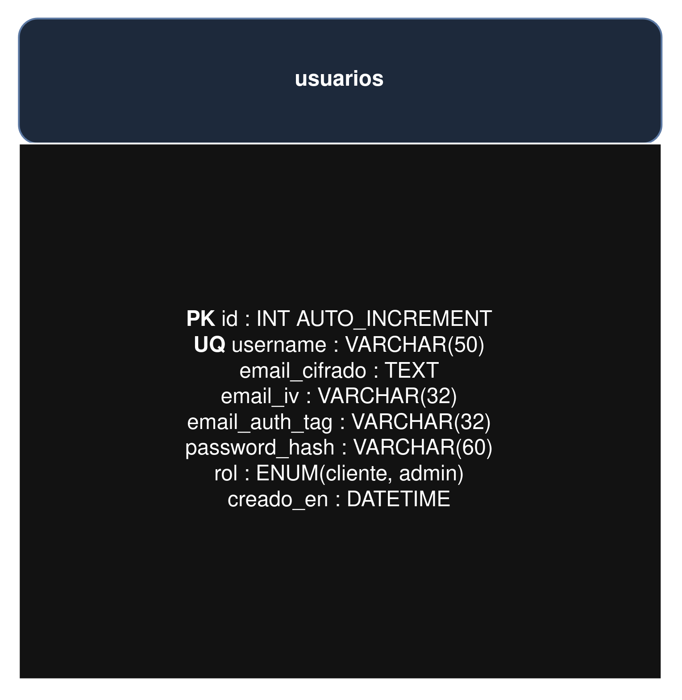
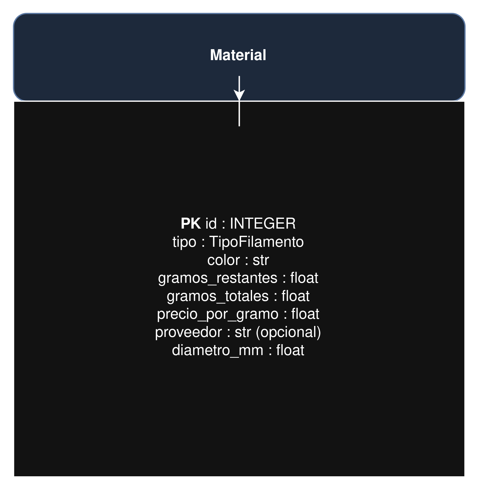
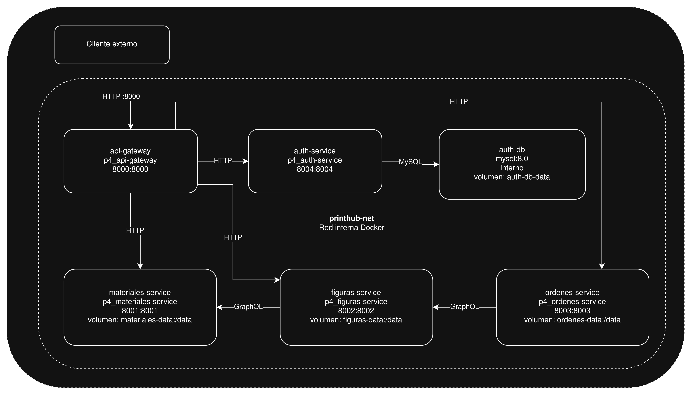

# Practica 4

Geovanni Eduardo Nufio Illescas  
201901444


# Indice

- [1. Tecnologías y patrones de diseño](#1-tecnologías-y-patrones-de-diseño)
- [2. Arquitectura General](#2-arquitectura-general)
  - [2.1 API Gateway](#21-api-gateway)
- [3. Diseño de microservicios](#3-diseño-de-microservicios)
  - [3.1 Auth Service](#31-auth-service)
  - [3.2 Materiales Service](#32-materiales-service)
  - [3.3 Figuras Service](#33-figuras-service)
  - [3.4 Ordenes Service](#34-ordenes-service)
- [4. Diagrama de Despliegue](#4-diagrama-de-despliegue)
- [5. Flujo de creación de una orden](#5-flujo-de-creación-de-una-orden)
- [6. Comunicación entre servicios](#6-comunicación-entre-servicios)

---

## 1. Tecnologías y patrones de diseño

### 1.1 Tecnologías

| Área | Tecnología |
|---|---|
| Autenticación | JWT (firmado con HS256) + AES-256-GCM para cifrado de datos sensibles en BD |
| API REST | Node.js + Express (auth-service, ordenes-service, api-gateway) |
| API GraphQL | Apollo Server (figuras-service), Strawberry + FastAPI (materiales-service) |
| Bases de datos | MySQL 8 (auth-db), SQLite con better-sqlite3 (figuras, ordenes), SQLite con SQLModel (materiales) |
| Despliegue | Docker Compose / Podman Compose con healthchecks |
| Comunicación interna | HTTP directo entre contenedores en la misma red (`printhub-net`) |

### 1.2 Patrones de diseño

* **API Gateway** — un único punto de entrada centraliza la validación del JWT y el enrutamiento hacia los servicios internos; los clientes nunca acceden directamente a los microservicios.
* **Proxy / Path Rewrite** — el gateway usa `http-proxy-middleware` para reescribir las rutas antes de reenviar la petición al servicio destino, manteniendo las rutas internas independientes de las externas.
* **Client / Anticorruption Layer** — `figurasClient.js` (ordenes-service) y `consumirGramosEnMateriales` (figuras-service/resolvers.js) aíslan la comunicación GraphQL inter-servicio del resto de la lógica de negocio.
* **Database per Service** — cada microservicio es dueño exclusivo de su base de datos; no hay acceso cruzado a nivel de SQL.
* **Healthcheck + Dependency ordering** — Docker Compose espera a que cada servicio pase su healthcheck antes de arrancar los que dependen de él, eliminando condiciones de carrera al inicio.

---

## 2. Arquitectura General



El sistema está compuesto por cinco microservicios y una base de datos dedicada para autenticación, todos corriendo en la red Docker `printhub-net`:

1. **api-gateway** — punto de entrada único (puerto 8000)
2. **auth-service** — registro, login y emisión de JWT (puerto 8004)
3. **materiales-service** — inventario de filamento, API GraphQL (puerto 8001)
4. **figuras-service** — catálogo de figuras imprimibles, API GraphQL (puerto 8002)
5. **ordenes-service** — gestión de órdenes de impresión, API REST (puerto 8003)

Cada microservicio es dueño de su propia base de datos. Las relaciones entre datos de distintos servicios se modelan como **claves foráneas lógicas** (referencias por ID), no como FK de SQL entre esquemas distintos. La comunicación entre servicios ocurre directamente en la red interna, sin pasar por el gateway.

### 2.1 API Gateway

El gateway actúa como único punto de entrada del sistema y cumple tres funciones:

1. **Enrutamiento**: dirige cada petición al microservicio correspondiente según el prefijo de ruta (`/api/auth`, `/api/materiales`, `/api/figuras`, `/api/ordenes`).
2. **Autenticación centralizada**: el middleware `requireAuth` valida el JWT (cookie HTTP-only o header `Authorization: Bearer`) antes de reenviar cualquier petición a los servicios protegidos; auth-service queda público porque es quien emite el token.
3. **Health agregado**: el endpoint `/health` del gateway consulta en paralelo el `/health` de los cuatro servicios y devuelve un resumen unificado del estado del sistema.

```js
// api-gateway/src/authMiddleware.js
export function requireAuth(req, res, next) {
  const token = extraerToken(req);
  if (!token) return res.status(401).json({ error: "No autenticado" });
  try {
    const payload = jwt.verify(token, JWT_SECRET);
    req.user = payload;
    next();
  } catch (err) {
    return res.status(401).json({ error: `Token inválido: ${err.message}` });
  }
}
```

---

## 3. Diseño de microservicios

### 3.1 Auth Service

**Tecnología:** Node.js + Express  
**Puerto:** 8004  
**Base de datos:** MySQL 8 (`auth-db`)

#### 3.1.1 ER Auth Service



La tabla `usuarios` almacena el email cifrado con AES-256-GCM. El cifrado no es determinístico (cada cifrado genera un IV distinto), por lo que se guardan tres columnas separadas: el texto cifrado, el IV y el authTag de autenticación. Sin los tres no es posible descifrar ni verificar la integridad del dato.

```sql
-- auth-service/init.sql
CREATE TABLE IF NOT EXISTS usuarios (
  id            INT AUTO_INCREMENT PRIMARY KEY,
  username      VARCHAR(50) NOT NULL UNIQUE,
  email_cifrado TEXT NOT NULL,
  email_iv      VARCHAR(32) NOT NULL,
  email_auth_tag VARCHAR(32) NOT NULL,
  password_hash VARCHAR(60) NOT NULL, -- bcrypt, 10 rounds
  rol           ENUM('cliente', 'admin') NOT NULL DEFAULT 'cliente',
  creado_en     DATETIME NOT NULL DEFAULT CURRENT_TIMESTAMP
);
```

#### 3.1.2 Endpoints REST

| Método | Ruta | Descripción | Auth |
|---|---|---|---|
| `GET` | `/health` | Estado del servicio | Pública |
| `POST` | `/register` | Registrar usuario | Pública |
| `POST` | `/login` | Iniciar sesión, devuelve JWT en cookie | Pública |
| `GET` | `/me` | Datos del usuario autenticado | Cookie JWT |
| `POST` | `/logout` | Eliminar cookie | Cookie JWT |

#### 3.1.3 Seguridad

* Contraseñas hasheadas con **bcrypt** (10 rondas).
* Email cifrado en base de datos con **AES-256-GCM** (`crypto.js`).
* JWT firmado con HS256, expiración 2 horas, entregado en cookie `httpOnly`.

---

### 3.2 Materiales Service

**Tecnología:** Python + FastAPI + Strawberry (GraphQL)  
**Puerto:** 8001  
**Base de datos:** SQLite (`materiales.db`)

#### 3.2.1 ER Materiales Service



```python
# materiales-service/app/models.py
class Material(SQLModel, table=True):
    id: Optional[int] = Field(default=None, primary_key=True)
    tipo: TipoFilamento          # Enum: PLA, PETG, ABS, ASA, TPU, NYLON
    color: str
    gramos_restantes: float      # se actualiza con cada impresión
    gramos_totales: float
    precio_por_gramo: float
    proveedor: Optional[str]
    diametro_mm: float           # default 1.75
```

#### 3.2.2 Schema GraphQL

| Operación | Nombre | Descripción |
|---|---|---|
| Query | `materiales` | Lista todos los materiales |
| Query | `material(id)` | Obtiene un material por ID |
| Query | `materialesPorTipo(tipo)` | Filtra por tipo de filamento |
| Mutation | `crearMaterial(datos)` | Registra un nuevo rollo de filamento |
| Mutation | `consumirGramos(datos)` | Descuenta gramos al imprimir (llamado por figuras-service) |
| Mutation | `eliminarMaterial(id)` | Elimina un material |

---

### 3.3 Figuras Service

**Tecnología:** Node.js + Apollo Server (GraphQL)  
**Puerto:** 8002  
**Base de datos:** SQLite (`figuras.db`)

#### 3.3.1 ER Figuras Service


```js
// figuras-service/src/db.js
CREATE TABLE IF NOT EXISTS figuras (
  id                    INTEGER PRIMARY KEY AUTOINCREMENT,
  nombre                TEXT NOT NULL,
  material_id           INTEGER NOT NULL,   -- FK lógica → materiales.id
  gramos_requeridos     REAL NOT NULL,
  piezas                INTEGER NOT NULL DEFAULT 1,
  alto_mm               REAL,
  ancho_mm              REAL,
  profundo_mm           REAL,
  tiempo_impresion_horas REAL,
  precio                REAL NOT NULL
);
```

#### 3.3.2 Schema GraphQL

| Operación | Nombre | Descripción |
|---|---|---|
| Query | `figuras` | Lista todas las figuras |
| Query | `figura(id)` | Obtiene una figura por ID |
| Query | `figurasPorMaterial(materialId)` | Filtra por material |
| Mutation | `crearFigura(datos)` | Registra una nueva figura |
| Mutation | `eliminarFigura(id)` | Elimina una figura |
| Mutation | `imprimirFigura(id, cantidad)` | Calcula gramaje y llama a `consumirGramos` en materiales-service |

La mutación `imprimirFigura` es la que genera la comunicación directa entre servicios: calcula `gramosRequeridos × cantidad` y hace una petición GraphQL a materiales-service para descontar el inventario.

```js
// figuras-service/src/resolvers.js
imprimirFigura: async (_parent, { id, cantidad }) => {
  const figura = rowToFigura(db.prepare("SELECT * FROM figuras WHERE id = ?").get(id));
  const gramosTotales = figura.gramosRequeridos * (cantidad ?? 1);
  const materialActualizado = await consumirGramosEnMateriales(figura.materialId, gramosTotales);
  // ...
}
```

---

### 3.4 Ordenes Service

**Tecnología:** Node.js + Express (REST)  
**Puerto:** 8003  
**Base de datos:** SQLite (`ordenes.db`)

#### 3.4.1 ER Ordenes Service


```js
// ordenes-service/src/db.js
CREATE TABLE IF NOT EXISTS ordenes (
  id              INTEGER PRIMARY KEY AUTOINCREMENT,
  cliente         TEXT NOT NULL,
  figura_id       INTEGER NOT NULL,   -- FK lógica → figuras.id
  cantidad        INTEGER NOT NULL,
  precio_unitario REAL NOT NULL,
  precio_total    REAL NOT NULL,
  estado          TEXT NOT NULL DEFAULT 'pendiente',
  fecha           TEXT NOT NULL DEFAULT (datetime('now')),
  nota            TEXT
);
```

Estados posibles: `pendiente`, `impresion`, `entregado`, `cancelado`.

#### 3.4.2 Endpoints REST

| Método | Ruta | Descripción |
|---|---|---|
| `GET` | `/health` | Estado del servicio |
| `GET` | `/ordenes` | Listar órdenes (filtro opcional por `?estado=`) |
| `GET` | `/ordenes/:id` | Obtener una orden |
| `POST` | `/ordenes` | Crear orden (consulta figura y dispara impresión) |
| `PATCH` | `/ordenes/:id/estado` | Actualizar estado de una orden |
| `DELETE` | `/ordenes/:id` | Eliminar una orden |

Al crear una orden, el servicio consulta primero el precio real de la figura en figuras-service (GraphQL query), y luego dispara la mutación `imprimirFigura` para reservar el material. Si la llamada a figuras-service falla, la orden queda creada en estado `pendiente` y se informa el error sin bloquear la respuesta.

---

## 4. Diagrama de Despliegue



Cada servicio corre en su propio contenedor dentro de la red `printhub-net`. Solo el api-gateway y los servicios individuales exponen puertos al host; la base de datos MySQL solo es accesible desde dentro de la red.

| Contenedor | Imagen | Puerto host:contenedor | Volumen |
|---|---|---|---|
| api-gateway | `p4_api-gateway` | 8000:8000 | — |
| auth-service | `p4_auth-service` | 8004:8004 | — |
| auth-db | `mysql:8.0` | — (interno) | `auth-db-data` |
| materiales-service | `p4_materiales-service` | 8001:8001 | `materiales-data:/data` |
| figuras-service | `p4_figuras-service` | 8002:8002 | `figuras-data:/data` |
| ordenes-service | `p4_ordenes-service` | 8003:8003 | `ordenes-data:/data` |

---

## 5. Flujo de creación de una orden

El flujo de una petición `POST /api/ordenes` atraviesa tres microservicios de forma encadenada y sincrónica:

```
Cliente
  → POST /api/ordenes  (con cookie JWT)
    → api-gateway  [valida JWT con requireAuth]
      → ordenes-service  POST /ordenes
          1. GraphQL query figura(id) → figuras-service
          2. Calcula precio total
          3. Inserta orden en SQLite (estado: 'pendiente')
          4. GraphQL mutation imprimirFigura(id, cantidad) → figuras-service
              └─ figuras-service calcula gramaje total
                 └─ GraphQL mutation consumirGramos → materiales-service
                    └─ materiales-service descuenta gramos en SQLite
          5. Actualiza estado de la orden a 'impresion'
      ← Devuelve { orden, impresion }
    ← 201 Created con datos de la orden e impresión
```

Si cualquier llamada inter-servicio falla, la orden queda creada pero se informa el error en el campo `impresion.mensaje` sin devolver un error HTTP al cliente.

---

## 6. Comunicación entre servicios

Se usa un modelo **híbrido sincrónico**, justificado por el tipo de operación:

* **REST** — para operaciones CRUD clásicas donde el cliente espera una respuesta directa:
  * `Cliente → Gateway → auth-service` (registro, login)
  * `Cliente → Gateway → ordenes-service` (CRUD de órdenes)

* **GraphQL** — para consultas flexibles con datos tipados y para llamadas inter-servicio con argumentos específicos:
  * `Cliente → Gateway → materiales-service` (consultas y mutaciones de inventario)
  * `Cliente → Gateway → figuras-service` (consultas y mutaciones del catálogo)
  * `ordenes-service → figuras-service` (query `figura` + mutation `imprimirFigura`)
  * `figuras-service → materiales-service` (mutation `consumirGramos`)

Las llamadas directas entre microservicios (`ordenes → figuras → materiales`) ocurren dentro de la red Docker sin pasar por el gateway, lo que evita una capa extra de latencia y validación de JWT innecesaria en tráfico interno de confianza.

---
