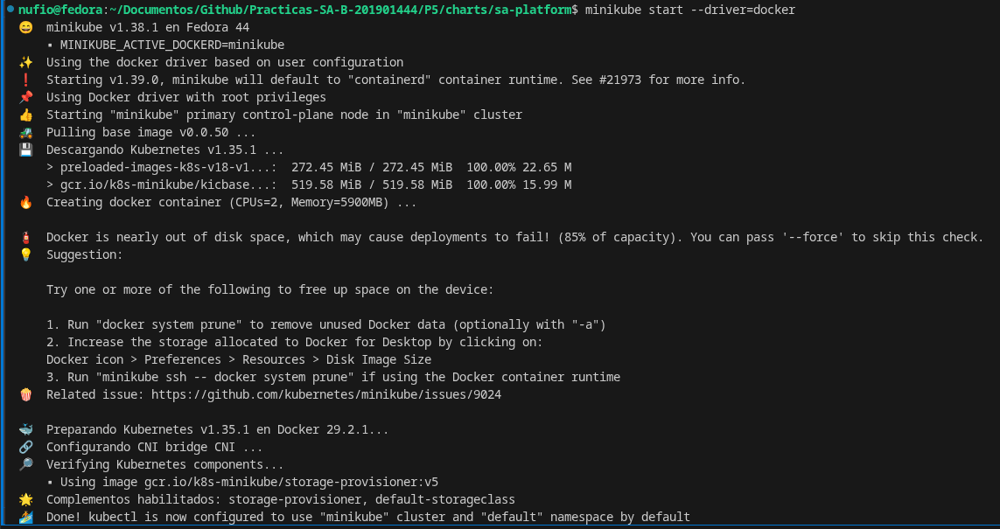

Checklist de evidencias a capturar (en orden de ejecución)

1. helm lint / dependencias

```
# Actualizar dependencias del chart
helm dependency update

# Validar la sintaxis y estructura del chart
helm lint .
```

2. Instalación inicial

```
# Iniciar el clúster local de Minikube
minikube start

# Habilitar addons de Ingress y Metrics Server
minikube addons enable ingress
minikube addons enable metrics-server

# Desplegar la aplicación mediante Helm pasando los archivos de valores
helm install sa-platform . -f values.yaml -f values-dev.yaml -f values.secrets.yaml -n sa-p5 --create-namespace

# Verificar el estado de todos los recursos en el namespace sa-p5
kubectl get all -n sa-p5

# Confirmar la creación del namespace gestionado por el chart
kubectl get ns sa-p5
```



3. Ciclo de vida Helm 

```
# 1. Modificar la versión en Chart.yaml (por ejemplo, incrementar 'version: 0.2.0')
# 2. Ejecutar la actualización del release
helm upgrade sa-platform . -f values.yaml -f values-dev.yaml -f values.secrets.yaml -n sa-p5

# Consultar el historial de revisiones del release
helm history sa-platform -n sa-p5

# Realizar un rollback hacia la versión inicial (Revisión 1)
helm rollback sa-platform 1 -n sa-p5

# Verificar de nuevo el historial para evidenciar el rollback completado
helm history sa-platform -n sa-p5
```

4. Persistencia (2.2 — parte de 10 pts)

 kubectl get pods -n sa-p5 -l app.kubernetes.io/name=mysql → identificar pod
 Insertar/consultar un dato (ej. login/registro)
 kubectl delete pod <mysql-pod> -n sa-p5
 Esperar que StatefulSet lo recree, volver a consultar el mismo dato → sigue ahí

5. Comunicación asíncrona (2.3 — 12 pts)

 Crear una orden → mostrar que POST /ordenes responde 202 de inmediato (no espera a figuras-service)
 Logs de figuras-service consumiendo ordenes.creadas y publicando ordenes.procesadas
 Logs de ordenes-service actualizando estado al consumir
 Consumidor caído: kubectl scale deploy sa-platform-figuras-service --replicas=0, crear varias órdenes, mostrar que se acumulan en la cola (rabbitmqctl list_queues o UI de management), luego --replicas=2 y mostrar que se procesan todas sin pérdida

6. Red y seguridad (2.4 — 10 pts)

 Mostrar que solo api-gateway tiene Ingress; kubectl get svc -n sa-p5 → nada es NodePort/LoadBalancer
 Bloqueo NetworkPolicy: desde un pod no autorizado (ej. kubectl run test --image=busybox -n sa-p5 --rm -it -- wget materiales-service:8001 o desde ordenes-service intentando pegarle directo a materiales-service, que no está en su egressTo) → debe fallar/timeout
 kubectl get sa,role,rolebinding -n sa-p5 → nada usa default
 kubectl get pod <pod> -o yaml | grep -A5 securityContext → runAsNonRoot, readOnlyRootFilesystem, allowPrivilegeEscalation, capabilities.drop

7. Escalado y resiliencia (2.5 — 10 pts)

 kubectl get resourcequota,limitrange -n sa-p5
 kubectl get pdb -n sa-p5
 Correr k6 run en paralelo con dos terminales: kubectl get hpa -w y kubectl get pods -w → capturar el escalado (2→5 réplicas) y el descenso al terminar la carga
 Zero-downtime: mientras corre un while true; do curl ...; sleep 0.2; done contra el gateway, ejecutar helm upgrade (cambiar tag de imagen) → mostrar log de requests sin ningún error durante el rollout

8. Cronjobs (2.6 — 6 pts)

 kubectl get cronjob -n sa-p5
 Esperar 2 min → kubectl get jobs,pods -n sa-p5 (heartbeat corrió) + query a la tabla mostrando fecha GMT-6 y carné
 Esperar 10 min → verificar que cronjob-resumen publicó en resumen.heartbeat y que auth-service lo consumió/almacenó

9. Prueba de carga (I — dentro de 2.5)

 Salida completa de k6 run (RPS, p95, % error)
 Los -w de HPA/pods del punto 7 sirven como evidencia cruzada

10. Tamaño de imágenes (G)

 docker images | grep sa-platform antes/después del multi-stage (o podman images) → tabla comparativa