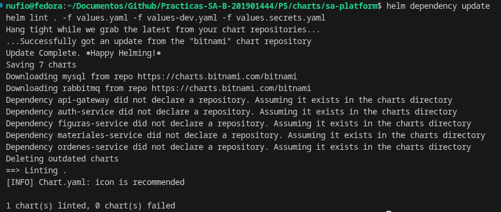
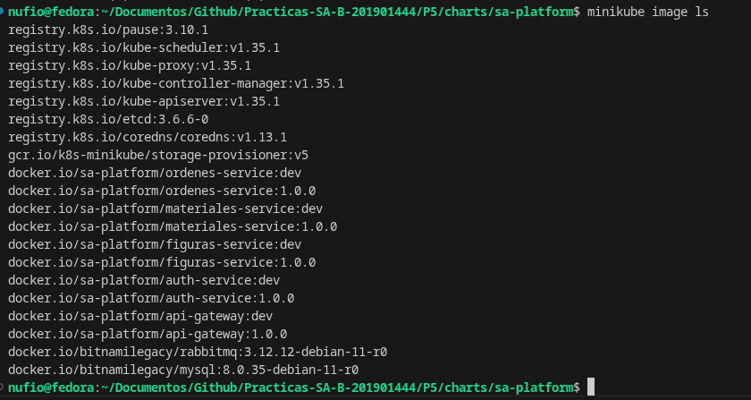
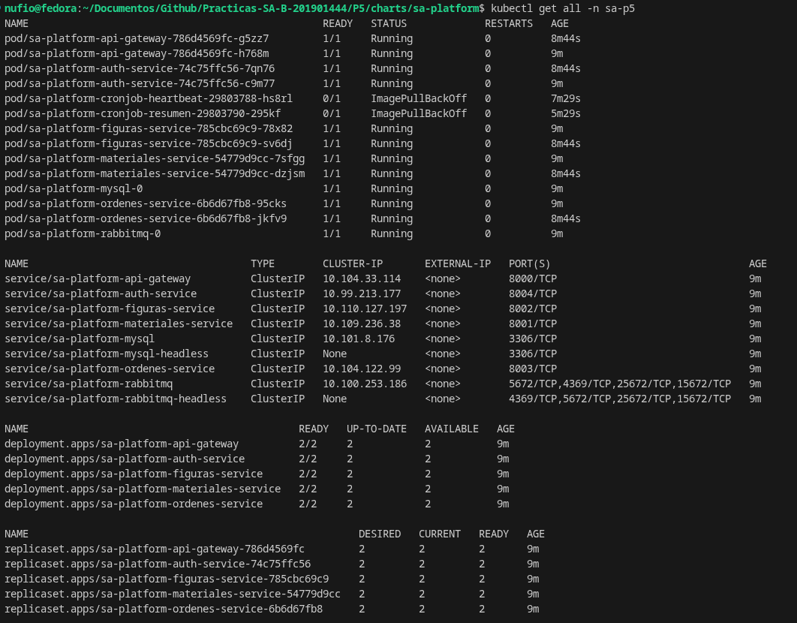

Geovanni Eduardo Nufio Illescas
201901444

# Checklist de evidencias (en orden de ejecución)

## 1. helm lint / dependencias

```bash
helm dependency update
helm lint .
```



---

## 2. Build de imágenes (Podman) y carga a Minikube

```bash
minikube start
minikube addons enable ingress
minikube addons enable metrics-server

docker build -t sa-platform/auth-service:1.0.0 ./auth-service
docker build -t sa-platform/materiales-service:1.0.0 ./materiales-service
docker build -t sa-platform/figuras-service:1.0.0 ./figuras-service
docker build -t sa-platform/ordenes-service:1.0.0 ./ordenes-service
docker build -t sa-platform/api-gateway:1.0.0 ./api-gateway

for img in auth-service materiales-service figuras-service ordenes-service api-gateway; do
  docker save sa-platform/${img}:1.0.0 | minikube image load -
done

minikube image ls | grep sa-platform
```



---

## 3. Instalación inicial

```bash
cd ~/Documentos/Github/Practicas-SA-B-201901444/P5/charts/sa-platform

cp values.example.yaml values.secrets.yaml
# editar values.secrets.yaml con valores reales

helm install sa-platform . -n sa-p5 --create-namespace \
  -f values.yaml -f values-dev.yaml -f values.secrets.yaml

kubectl get all -n sa-p5
kubectl get ns sa-p5
```



---

## 4. Ciclo de vida Helm (install, upgrade, rollback)

```bash
# 1. Incrementar version en Chart.yaml (ej. 0.1.0 -> 0.2.0)
helm upgrade sa-platform . -n sa-p5 \
  -f values.yaml -f values-dev.yaml -f values.secrets.yaml

helm history sa-platform -n sa-p5

helm rollback sa-platform 1 -n sa-p5

helm history sa-platform -n sa-p5
```


---

## 5. Persistencia

```bash
kubectl get pods -n sa-p5 -l app.kubernetes.io/name=mysql

# Registrar/loguear un usuario vía el gateway (inserta dato)
curl -X POST http://sa-p5.local/api/auth/register \
  -H "Content-Type: application/json" \
  -d '{"username":"demo","email":"demo@example.com","password":"demo12345"}'

# Borrar el pod de MySQL
kubectl delete pod <mysql-pod> -n sa-p5

# Esperar a que el StatefulSet lo recree
kubectl get pods -n sa-p5 -l app.kubernetes.io/name=mysql -w

# Confirmar que el usuario sigue existiendo
curl -X POST http://sa-p5.local/api/auth/login \
  -H "Content-Type: application/json" \
  -d '{"username":"demo","password":"demo12345"}'
```

📷 _Captura: pod de MySQL recreado (`Running`) tras el delete._
📷 _Captura: login exitoso post-recreación, demostrando persistencia._

---

## 6. Comunicación asíncrona

```bash
curl -i -X POST http://sa-p5.local/api/ordenes \
  -H "Content-Type: application/json" \
  -b "token=<JWT>" \
  -d '{"cliente":"demo","figuraId":1,"cantidad":2}'
# Debe responder 202 de inmediato

kubectl logs -n sa-p5 -l sa-platform/component=figuras-service -f
kubectl logs -n sa-p5 -l sa-platform/component=ordenes-service -f

# Simular consumidor caído
kubectl scale deploy sa-platform-figuras-service --replicas=0 -n sa-p5

# Crear varias órdenes (se acumulan en la cola)
for i in 1 2 3; do
  curl -X POST http://sa-p5.local/api/ordenes \
    -H "Content-Type: application/json" -b "token=<JWT>" \
    -d "{\"cliente\":\"demo$i\",\"figuraId\":1,\"cantidad\":1}"
done

kubectl exec -n sa-p5 -it <rabbitmq-pod> -- rabbitmqctl list_queues

# Reactivar consumidor
kubectl scale deploy sa-platform-figuras-service --replicas=2 -n sa-p5
kubectl exec -n sa-p5 -it <rabbitmq-pod> -- rabbitmqctl list_queues
```

📷 _Captura: respuesta `202` inmediata del POST /ordenes._
📷 _Captura: logs de figuras-service consumiendo `ordenes.creadas` y publicando `ordenes.procesadas`._
📷 _Captura: logs de ordenes-service actualizando estado al consumir._
📷 _Captura: `rabbitmqctl list_queues` con mensajes acumulados (consumidor en 0)._
📷 _Captura: `rabbitmqctl list_queues` en 0 tras reactivar el consumidor (todas procesadas)._

---

## 7. Red y seguridad

```bash
kubectl get svc -n sa-p5
# Solo api-gateway con Ingress; nada NodePort/LoadBalancer

kubectl get ingress -n sa-p5

# Bloqueo de NetworkPolicy: pod no autorizado
kubectl run test --image=busybox -n sa-p5 --rm -it -- \
  wget -T 3 sa-platform-materiales-service:8001
# Debe fallar/timeout

kubectl get sa,role,rolebinding -n sa-p5

kubectl get pod <pod> -n sa-p5 -o yaml | grep -A5 securityContext
```

📷 _Captura: `kubectl get svc -n sa-p5` (sin NodePort/LoadBalancer)._
📷 _Captura: intento fallido de acceso directo a materiales-service desde pod no autorizado._
📷 _Captura: `kubectl get sa,role,rolebinding -n sa-p5` (ningún recurso usa `default`)._
📷 _Captura: `securityContext` con `runAsNonRoot`, `readOnlyRootFilesystem`, `allowPrivilegeEscalation: false`, `capabilities.drop`._

---

## 8. Escalado y resiliencia

```bash
kubectl get resourcequota,limitrange -n sa-p5
kubectl get pdb -n sa-p5

# Terminal 1
kubectl get hpa -n sa-p5 -w

# Terminal 2
kubectl get pods -n sa-p5 -w

# Terminal 3
k6 run k6/load-test.js --env BASE_URL=http://sa-p5.local

# Zero-downtime upgrade (mientras corre k6 o en paralelo)
while true; do curl -s -o /dev/null -w "%{http_code}\n" http://sa-p5.local/health; sleep 0.2; done
# En otra terminal, cambiar tag de imagen y:
helm upgrade sa-platform . -n sa-p5 -f values.yaml -f values-dev.yaml -f values.secrets.yaml
```

📷 _Captura: `kubectl get resourcequota,limitrange -n sa-p5`._
📷 _Captura: `kubectl get pdb -n sa-p5`._
📷 _Captura: `kubectl get hpa -w` mostrando escalado 2→5 réplicas bajo carga y descenso al terminar._
📷 _Captura: `kubectl get pods -w` durante el escalado._
📷 _Captura: log del `while true curl` sin códigos de error durante el `helm upgrade`._

---

## 9. Prueba de carga (k6)

```bash
k6 run k6/load-test.js --env BASE_URL=http://sa-p5.local
```

📷 _Captura: salida completa de k6 (RPS, p95, % error, thresholds pasados)._

---

## 10. Tamaño de imágenes

```bash
podman images | grep sa-platform
```

| Imagen | Antes (single-stage) | Después (multi-stage) |
|---|---|---|
| auth-service | | |
| materiales-service | | |
| figuras-service | | |
| ordenes-service | | |
| api-gateway | | |

📷 _Captura: `podman images | grep sa-platform`._

---

## 11. Cronjobs

```bash
kubectl get cronjob -n sa-p5

# Esperar 2 min
kubectl get jobs,pods -n sa-p5

# Query a la tabla (fecha GMT-6 y carné)
kubectl exec -n sa-p5 -it <mysql-pod> -- \
  mysql -u root -p auth_db -e "SELECT * FROM heartbeats ORDER BY id DESC LIMIT 5;"

# Esperar 10 min
kubectl exec -n sa-p5 -it <rabbitmq-pod> -- rabbitmqctl list_queues
# Verificar que auth-service consumió resumen.heartbeat
kubectl logs -n sa-p5 -l sa-platform/component=auth-service --tail=50
```

📷 _Captura: `kubectl get cronjob -n sa-p5`._
📷 _Captura: `kubectl get jobs,pods -n sa-p5` tras 2 min (heartbeat corrió)._
📷 _Captura: query mostrando fecha GMT-6 y carné 201901444._
📷 _Captura: logs de auth-service consumiendo `resumen.heartbeat`._