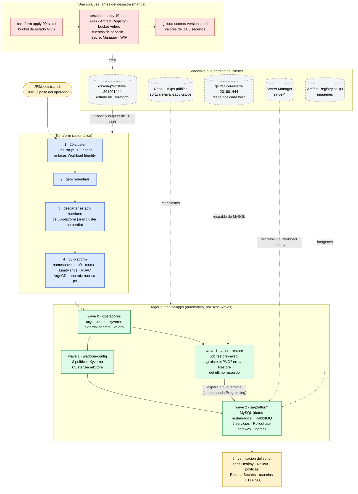

# Diagrama del bootstrap

Orden de reconstrucción del entorno `sa-p9` y dependencias entre componentes. Se distingue lo que
se hace **una sola vez a mano** (capas persistentes, antes de cualquier desastre), lo que dispara el
operador en la recuperación (**un solo comando**) y lo que ocurre **automáticamente**.

| Color | Significado |
|---|---|
| Rojo | Manual, una sola vez al preparar el proyecto (no forma parte de la recuperación) |
| Amarillo | Lo que ejecuta el operador: un solo comando, y la verificación final del mismo script |
| Azul | Automático, Terraform |
| Verde | Automático, ArgoCD a partir del repo GitOps |
| Gris punteado | Dependencias externas al clúster que sobreviven a su pérdida |

**Por qué este orden:**

- **Terraform antes de ArgoCD.** ArgoCD necesita un clúster y el namespace `sa-p9` con su cuota;
  el resto ya lo describe el repo GitOps.
- **Operadores antes que su configuración (wave 0 → 1).** Las políticas, el ClusterSecretStore y los
  Restore son recursos de CRDs que instalan Kyverno, External Secrets y Velero.
- **Restauración antes de la plataforma (wave 1 → 2).** Si `sa-platform` se sincronizara primero,
  el StatefulSet de MySQL crearía un PVC vacío y Velero ya no restauraría sobre él. El Job
  `restore-mysql` mantiene la wave 1 en `Progressing` hasta que el Restore termina.
- **Secretos al final.** El pod restaurado de MySQL espera el secreto `sa-platform-mysql-auth`,
  que External Secrets crea en la wave 2 desde Secret Manager. La copia de datos no lo necesita:
  Velero la hace en un init container antes de que arranque MySQL.
